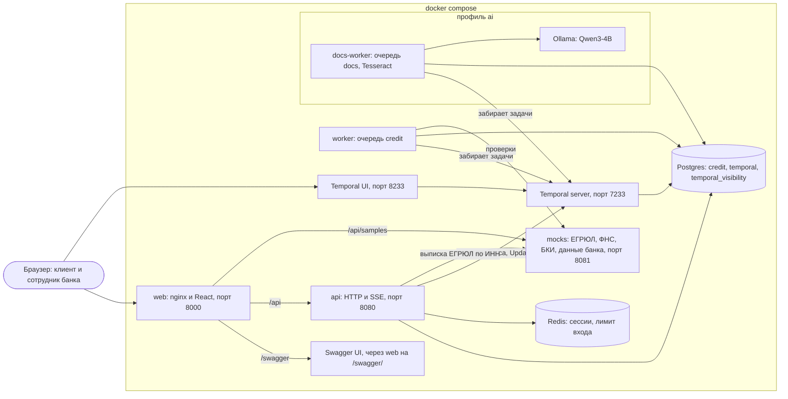
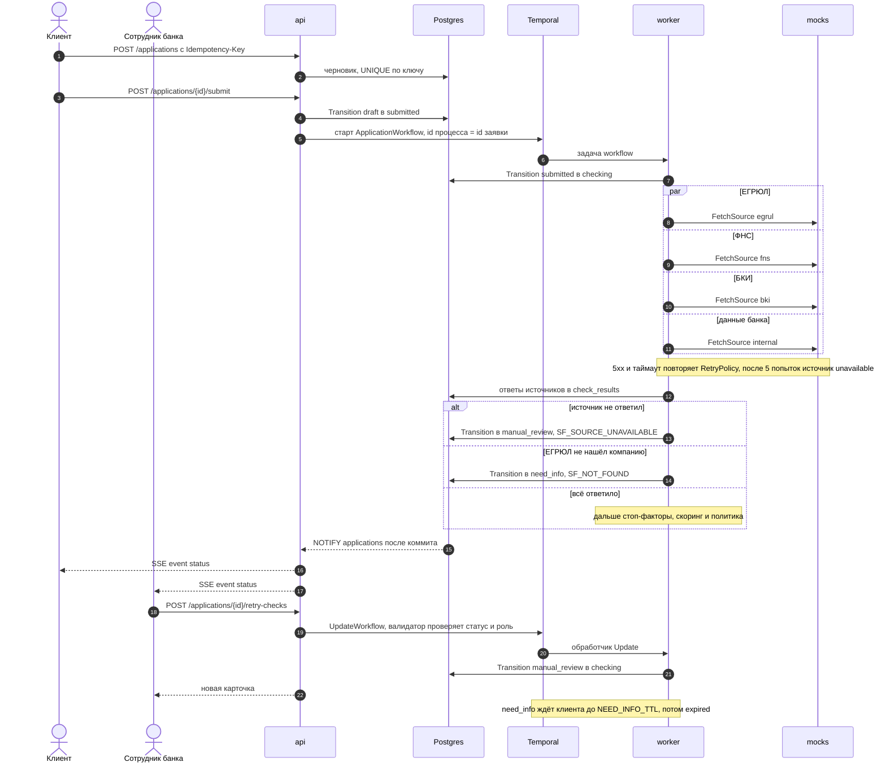
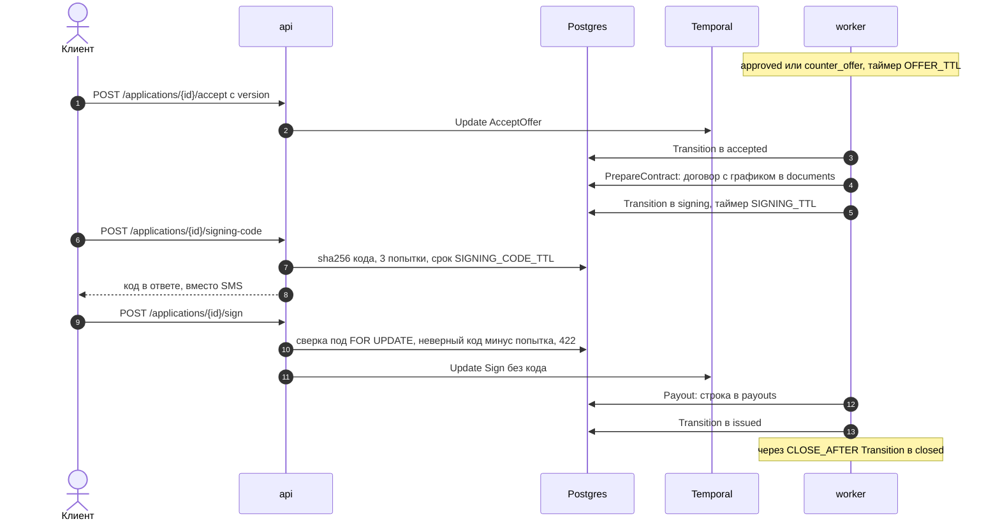

# Архитектура

Модульный монолит: один Go-модуль, четыре процесса (`api`, `worker`, `docs-worker`, `mocks`), одна база. Процесс заявки ведёт Temporal, статус и журнал живут в Postgres. Почему так, в [decisions.md](decisions.md), статусы в [state-diagram.md](state-diagram.md), таблицы в [data-model.md](data-model.md).

## Компоненты

Одноразовые контейнеры на схеме не показаны: `temporal-setup` создаёт базы Temporal и накатывает схему, `temporal-namespace` заводит namespace `default`, `ollama-pull` скачивает модель. Миграции и демо-сид накатывает сам `api` при старте.

Воркеры ничего не слушают снаружи: они сами забирают задачи из своей очереди Temporal. Поэтому `docs-worker` можно не поднимать вовсе, заявки идут без него, документ получает статус `skipped`.

## Путь заявки

Каждая смена статуса проходит через `Transition` в `internal/usecase/application.go`: одна транзакция, в ней `SELECT ... FOR UPDATE`, проверка по таблице переходов, `version + 1`, запись в журнал `application_events` и `pg_notify`. Workflow вызывает его из activity, подача из `api` напрямую. Temporal решает, что делать дальше, интерфейс и журнал читают только Postgres.

Действия людей (`provide-info`, `request-info`, `retry-checks`, `decision`, `accept`, `sign`, `cancel` по поданной заявке) `api` отправляет в процесс как Workflow Update и ждёт результата. Не к месту действие отклоняет валидатор до записи в историю процесса, клиент получает 409 `illegal_transition`.

После проверок activity `Decide` считает решение по последним ответам источников, анкете и документам: стоп-факторы, а если они не остановили, скоринг и политику по `rules/*.yaml`. Сама activity ничего не пишет, решение ложится в `decisions` в той же транзакции, что и переход, поэтому её повтор безопасен. Жёсткий стоп-фактор ведёт заявку из `checking` сразу в `rejected` или `need_info`, иначе через `scoring` в исход политики; мягкие (например `SF_DOC_MISMATCH`) не останавливают скоринг, но исход у них `manual_review`. Решение андеррайтера приходит Update `Decide`. Дальше процесс ждёт, пока клиент примет условия (Update `AcceptOffer`) или срок `OFFER_TTL` уведёт заявку в `expired`. После принятия activity `PrepareContract` собирает договор с графиком в PDF и кладёт в документы, заявка уходит в `signing`. Код подписи сверяет `api` по хэшу в базе, процессу приходит Update `Sign` уже без кода: activity `Payout` пишет смоделированную выдачу, заявка в `issued`, через `CLOSE_AFTER` в `closed`. Договор и выдача идемпотентны по id заявки, повтор activity ничего не дублирует.

## Где что лежит

| Каталог | Что там |
|---|---|
| `api/openapi.yaml` | контракт, из него генерируются сервер (`internal/api/oapi`) и типы фронта (`web/src/api/schema.gen.ts`) |
| `cmd/{api,worker,docs-worker,mocks,docgen}` | только сборка зависимостей и запуск |
| `internal/domain` | статусы, роли, таблица переходов, коды причин, ошибки; без I/O |
| `internal/usecase` | логика и транзакции: заявки, проверки, документы, скоринг и политика, договор, код подписи и выдача, вход |
| `internal/repo`, `internal/db` | доступ к данным; SQL руками в `internal/db/queries`, код генерирует sqlc |
| `internal/api/{handler,middleware,server}` | перевод типов API в доменные, сессия и права, ошибки в `application/problem+json` |
| `internal/worker/{workflow,activity}` | процессы Temporal и их шаги |
| `internal/integration` | клиенты ЕГРЮЛ, источников проверок, Tesseract, Ollama |
| `internal/mocks` | симулятор внешних систем на фикстурах |
| `internal/rbac` | политика casbin |
| `migrations/` | схема и демо-сид |
| `rules/` | продукты, скоринг и политика в YAML |
| `pkg/` | инфраструктура без предметной области: логгер, пул Postgres и транзакции, Redis, запуск сервисов |

Зависимости идут в одну сторону: handler и activity зовут usecase, usecase зовёт repo. Типы API не выходят из `internal/api`, строки sqlc не выходят из `repo`.

## Переезд в Kubernetes

Манифестов в репо нет, стенд проверяется через compose. `api` и `worker` состояния не держат и становятся Deployment с несколькими репликами: сессии в Redis, задачи воркерам раздаёт очередь Temporal, миграции при старте `api` идут под advisory lock, так что одновременный старт реплик безопасен (либо их выносим в Job перед выкаткой). `docs-worker` отдельный Deployment со своими лимитами CPU и памяти, при необходимости на узлах с GPU. `/api/health` подходит для readiness, для liveness стоит завести лёгкий эндпоинт без проверки зависимостей, у воркеров HTTP-проверки сейчас нет. Конфиг уже весь из переменных окружения, он ложится в ConfigMap и Secret. Postgres и Redis берутся управляемые или через оператор, Temporal ставится официальным Helm-чартом отдельным кластером. `mocks` в проде заменяются настоящими интеграциями за теми же клиентами в `internal/integration`.

## Безопасность и надёжность

Вход: пароль в bcrypt, неверный логин и неверный пароль дают одинаковый 401, для несуществующего логина bcrypt тоже считается. Сессия хранится в Redis с TTL, в cookie `session` (HttpOnly, SameSite=Lax, Secure по `COOKIE_SECURE`) лежит JWT HS256 только с id сессии, допустимый алгоритм задан явно. Выход удаляет сессию, токен сразу перестаёт работать. Попытки входа считаются по IP в Redis, общий счётчик для всех реплик, превышение даёт 429.

Права: casbin, политика в `internal/rbac/policy.csv`, роль против пути и метода; аноним может только войти и спросить health. Владение проверяет SQL: чужая заявка отвечает 404, как несуществующая. Кто какой переход может сделать, решает таблица переходов в `internal/domain/transition.go`. Входящие запросы валидируются по `api/openapi.yaml` до хендлеров.

Идемпотентность: черновик создаётся с `Idempotency-Key`, в базе UNIQUE по автору и ключу, тот же ключ с другим телом даёт 409 `idempotency_conflict`. id процесса равен id заявки, второй старт Temporal не примет. `Transition` при повторе после коммита видит целевой статус и ничего не делает, поэтому activity можно ретраить.

Конкурентные правки: у заявки `version`, правка черновика с устаревшей версией даёт 409 `version_conflict`. Переход берёт строку `FOR UPDATE`, параллельные переходы встают в очередь, а не перетирают друг друга.

Аудит: `application_events` только дописывается, триггер не даёт сделать UPDATE или DELETE. В журнале автор, роль, коды причин, комментарий и время.

Ретраи: только через `RetryPolicy` Temporal (`internal/worker/workflow/options.go`). Запись в базу до 10 попыток с ростом интервала до 30 с, внешний источник 5 попыток по 5 с, потом источник считается недоступным, а заявка уходит специалисту с `SF_SOURCE_UNAVAILABLE`. Доменные ошибки (не найдено, запрещённый переход, конфликт версии) помечаются как неповторяемые. Упавший воркер процесс не теряет: после рестарта Temporal продолжит с последнего шага.

Здоровье: `GET /api/health` проверяет Postgres, Temporal и Redis, при сбое любого отвечает 503 `degraded`. В compose у каждого сервиса healthcheck, Go-сервисы проверяют себя тем же бинарём с флагом `-healthcheck` (в distroless нет curl), запуск идёт по `depends_on: service_healthy`. Процессы гасятся по SIGTERM с graceful shutdown.

Наблюдаемость (профиль `obs`): каждый процесс отдаёт метрики Prometheus на внутреннем порту 9100 и шлёт трейсы OpenTelemetry в Jaeger. Контекст трейса проходит через Temporal, поэтому подача заявки видна одним трейсом от HTTP-запроса до activity, вызовов моков и SQL. Логи контейнеров собирает Alloy в Loki, в Grafana готовый дашборд: бизнес-показатели из Postgres, запросы, ошибки и ретраи из Prometheus, ошибки из Loki со ссылкой на трейс. Без профиля процессы метрики отдают, но трейсы не шлют.

Секреты только из окружения: `JWT_SECRET` и `DATABASE_URL` обязательные, без них процесс не стартует; значения в `compose.yaml` годятся только для локального стенда. Логи JSON в stdout, без персональных данных.
