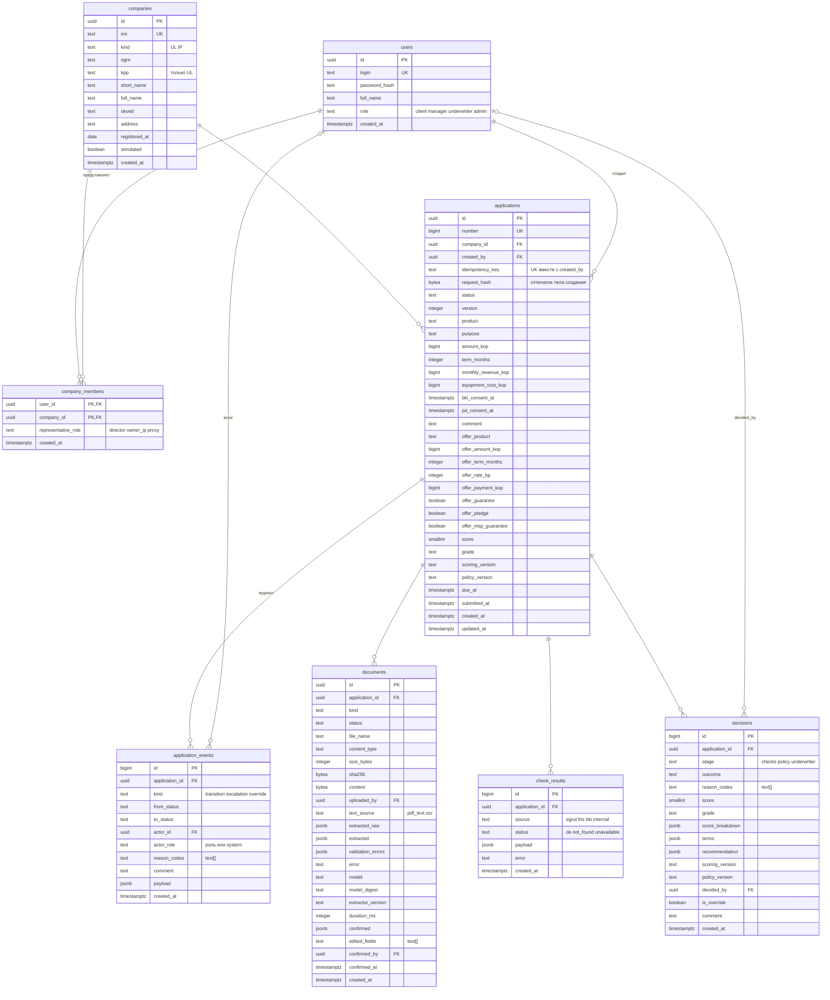

# Модель данных

Схема в `migrations/` (начало в `000001_init.up.sql`), это первоисточник. Деньги в копейках `bigint`, ставки в базисных пунктах, время `timestamptz` в UTC. Перечисления это `text` с CHECK, значения совпадают с enum в `api/openapi.yaml`. Ключи `uuid` v7 (`uuidv7()` из Postgres 18), чтобы новые строки ложились в конец индекса.

## Таблицы

**users.** Тестовые учётки из сида, пароль в bcrypt. Роль одна на пользователя, права роли в `internal/rbac/policy.csv`.

**companies.** Компания по ИНН с данными ЕГРЮЛ/ЕГРИП на момент первой заявки. Демо-компании вместе с представителями заранее заводит сид (`migrations/seed/demo.sql`, при `SEED_DEMO=true`). Тип и длина ИНН согласованы в CHECK: 10 цифр у `UL`, 12 у `IP`, КПП только у юрлица. `simulated` ставится компаниям из генератора симулятора, в кабинете у них плашка «данные сгенерированы».

**company_members.** Кто может действовать от имени компании и в какой роли. По этой таблице SQL проверяет владение: клиент видит заявки только своих компаний. Строка появляется при создании первой заявки по ИНН. Полномочия `director` сверяются с руководителем из ЕГРЮЛ, для `proxy` нужна загруженная доверенность.

**applications.** Заявка и её текущее состояние. `status` меняет только `Transition` в `usecase.ApplicationUseCase` под `SELECT ... FOR UPDATE`, каждый раз `version + 1`. `(created_by, idempotency_key)` уникален: повторный POST с тем же ключом отдаёт ту же заявку, а `request_hash` (sha256 тела) отличает настоящий повтор от другого черновика под тем же ключом, тогда 409. С полями сравнивать нельзя: черновик к повтору могли поправить. Поля `offer_*` это действующие условия, которые клиент принимает; история решений в `decisions`. `score` и `grade` продублированы из последнего решения ради фильтров очереди банка. `due_at` это срок текущего шага (ответ клиента, SLA андеррайтера), его же видит клиент.

**application_cards** (view). Заявка с реквизитами компании и ролью автора в ней: из неё читают карточка и список, чтобы набор полей был один.

**application_events.** Журнал аудита, только дописывается: UPDATE и DELETE падают на триггере. `transition` пишется на каждый переход в той же транзакции, `escalation` когда истёк SLA ручного рассмотрения, `override` когда андеррайтер отошёл от рекомендации политики. У `system` нет `actor_id`, у людей есть. Запрос уточнений хранит в `payload` список нужных документов, из него собирается карточка «Нужно от вас».

**documents.** Файл (до 10 МБ, в `bytea`) и всё про распознавание: что вернула модель как есть, что прошло проверку, ошибки проверки, что подтвердил клиент и какие поля он поправил, модель и её digest. Распознаются только `statement` и `financials`, остальные виды всегда `uploaded`. В скоринг идёт только `confirmed`. Смену статуса триггер `documents_notify` шлёт в тот же канал `applications`, что и переходы заявки: статус меняют и api, и docs-worker, а забыть уведомление так нельзя.

**check_results.** Ответы моков ЕГРЮЛ, ФНС, БКИ и внутренних данных по заявке. После `need_info` источники запрашиваются заново новой строкой, актуален последний по каждому источнику, старые остаются для аудита.

**decisions.** История решений: стоп-факторы на `checks`, скоринг и политика на `policy`, ручное решение на `underwriter`. Хранит коды причин, разбивку скоринга по факторам, условия и рекомендацию политики, версии `scoring.yaml` и `policy.yaml`, по которым принято. Решение андеррайтера без комментария не запишется.
