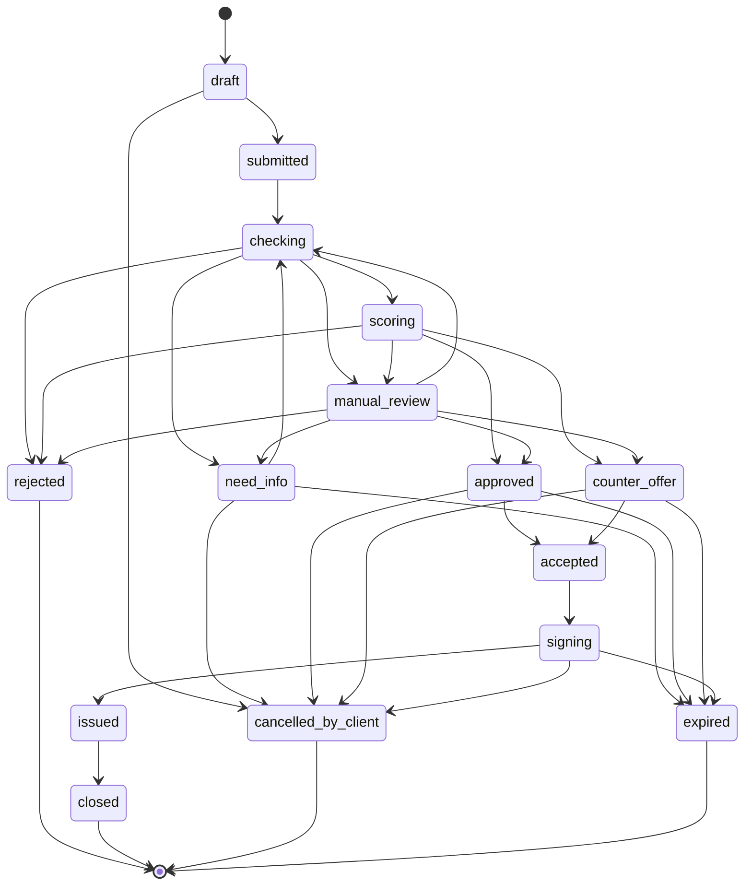

# Статусы заявки

Блок Mermaid ниже сверяется golden-тестом с таблицей переходов `internal/domain/transition.go`: тест рендерит диаграмму из таблицы и сравнивает с файлом. Формат держим каноническим: один переход на строку, только коды, в порядке таблицы ниже. Подписи и условия живут в таблице, а не на стрелках.

## Статусы

| Код | В интерфейсе | Кто ждёт | Подсказка клиенту |
|---|---|---|---|
| `draft` | Черновик | клиент | Заполните анкету и подайте заявку |
| `submitted` | Подана | система | Заявка принята, начинаем проверку |
| `checking` | Проверяем данные | система | Сверяем данные с реестрами и бюро, обычно пару минут |
| `need_info` | Нужны уточнения | клиент | Банку не хватает данных, загрузите их до срока |
| `scoring` | Оцениваем риск | система | Считаем уровень риска и подбираем условия |
| `approved` | Одобрено | клиент | Условия одобрены, примите их до срока |
| `counter_offer` | Есть предложение | клиент | Запрошенные условия не подошли, предлагаем другие |
| `manual_review` | На рассмотрении у специалиста | андеррайтер | Заявку смотрит специалист, ответ до конца рабочего дня |
| `rejected` | Отказ | | Причины и что можно сделать |
| `accepted` | Условия приняты | система | Готовим документы |
| `signing` | Подписание | клиент | Проверьте документы и подпишите кодом |
| `issued` | Деньги выданы | | Деньги на счёте |
| `closed` | Завершена | | |
| `cancelled_by_client` | Отменена вами | | |
| `expired` | Срок истёк | | Можно подать новую заявку |

Финальные: `rejected`, `closed`, `cancelled_by_client`, `expired`. Из них переходов нет, для новой попытки заводят новую заявку.

## Переходы

В колонке «Кто» `system` означает `ApplicationWorkflow`, остальное роли. Действие человека идёт через API в Workflow Update (в скобках операция OpenAPI), сам переход всегда делает `Transition` из `internal/usecase/application.go`, вызванный из activity. Сроки: прод / демо, задаются в конфиге.

| Из | В | Кто | Условие | Срок, таймер |
|---|---|---|---|---|
| | `draft` | client | создал заявку (`createApplication`) | |
| `draft` | `submitted` | client | анкета полная, есть полномочия, согласие на БКИ (`submitApplication`); стартует workflow | |
| `draft` | `cancelled_by_client` | client | `cancelApplication` | |
| `submitted` | `checking` | system | старт workflow | сразу |
| `checking` | `need_info` | system, manager, underwriter | стоп-фактор с исходом `need_info` или запрос сотрудника (`requestInfo`) | |
| `checking` | `rejected` | system | жёсткий стоп-фактор | |
| `checking` | `manual_review` | system | источник не ответил после ретраев (`SF_SOURCE_UNAVAILABLE`) | |
| `checking` | `scoring` | system | проверки пройдены | |
| `need_info` | `checking` | client | ответил на запрос (`provideInfo`) | |
| `need_info` | `expired` | system | клиент не ответил | 5 раб. дней / 3 мин |
| `need_info` | `cancelled_by_client` | client | `cancelApplication` | |
| `scoring` | `approved` | system | политика: условия как запрошены | |
| `scoring` | `counter_offer` | system | политика: изменены сумма, срок или продукт | |
| `scoring` | `manual_review` | system | класс D, сумма выше лимита авторешения или мягкий стоп-фактор (`SF_DOC_MISMATCH` и др.) | |
| `scoring` | `rejected` | system | класс E или лимит ниже минимума всех продуктов | |
| `manual_review` | `approved` | underwriter | решение с комментарием (`decideApplication`) | SLA 1 раб. день / 5 мин: по таймеру только событие `escalation`, статус не меняется |
| `manual_review` | `counter_offer` | underwriter | то же | то же |
| `manual_review` | `rejected` | underwriter | то же | то же |
| `manual_review` | `need_info` | underwriter, manager | запрос документа (`requestInfo`) | |
| `manual_review` | `checking` | manager | повторить проверки, если был `SF_SOURCE_UNAVAILABLE` (`retryChecks`) | |
| `approved` | `accepted` | client | принял условия (`acceptOffer`) | |
| `approved` | `cancelled_by_client` | client | отказался (`cancelApplication`) | |
| `approved` | `expired` | system | не принял | 10 раб. дней / 5 мин |
| `counter_offer` | `accepted` | client | принял условия (`acceptOffer`) | |
| `counter_offer` | `cancelled_by_client` | client | отказался (`cancelApplication`) | |
| `counter_offer` | `expired` | system | не принял | 10 раб. дней / 5 мин |
| `accepted` | `signing` | system | договор и график сформированы; отмены из `accepted` нет | сразу |
| `signing` | `issued` | client | ввёл верный код (`requestSigningCode`, затем `signApplication`), выдача смоделирована | код: 3 попытки, живёт 5 мин |
| `signing` | `cancelled_by_client` | client | `cancelApplication` | |
| `signing` | `expired` | system | не подписал | 3 раб. дня / 5 мин |
| `issued` | `closed` | system | постобработка | 1 день / 1 мин |

`allowed_next` в карточке заявки содержит переходы из текущего статуса, где в колонке «Кто» есть роль пользователя. Фронт рисует кнопки по нему, `system` в нём не бывает.
